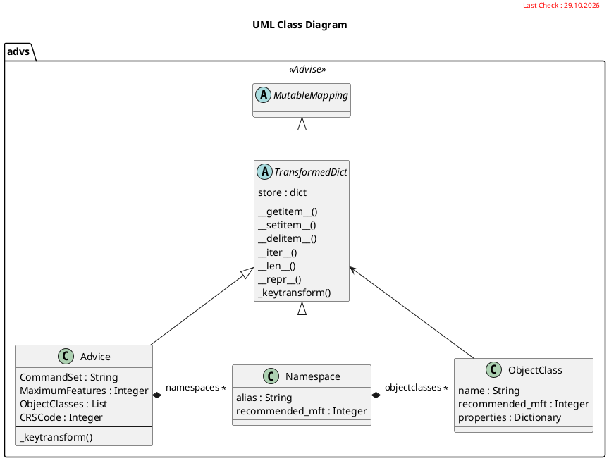

# Advice Classes

This UML diagram shows the the Classes used to generate the Advice.yml file.

<!--
!include https://raw.githubusercontent.com/3dcitydb/citydb-3dtiler/main/docs/card-style.puml
-->

