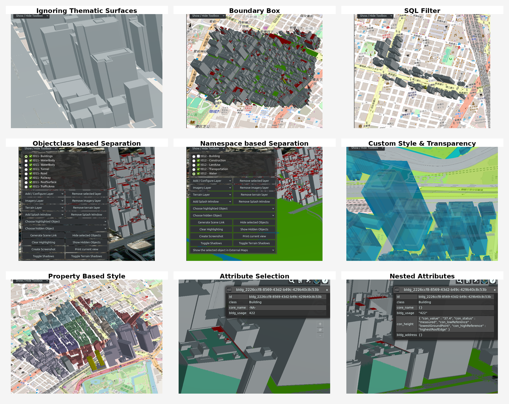

# Advise



## T001

```bash
python3 citydb-3dtiler.py \
--db-host 172.17.0.2 --db-port 5432 \
--db-name citydb-visualizer \
--db-schema citydb \
--db-username tester --db-password louvre \
advise
```

## T002

```bash
python3 citydb-3dtiler.py \
--db-host 172.17.0.2 --db-port 5432 \
--db-name citydb-visualizer \
--db-schema citydb \
--db-username tester --db-password louvre \
--ignore-thematic-surfaces \
advise
```

# Tiling

## T003

```bash
python3 citydb-3dtiler.py \
--db-host 172.17.0.2 --db-port 5432 \
--db-name citydb-visualizer \
--db-schema citydb \
--db-username tester --db-password louvre \
tile
```

## T004

```bash
python3 citydb-3dtiler.py \
--db-host 172.17.0.2 --db-port 5432 \
--db-name citydb-visualizer \
--db-schema citydb \
--db-username tester --db-password louvre \
--ignore-thematic-surfaces \
tile
```

## T005

```bash
python3 citydb-3dtiler.py \
--db-host 172.17.0.2 --db-port 5432 \
--db-name citydb-visualizer \
--db-schema citydb \
--db-username tester --db-password louvre \
--id bldg_97287e3a-7844-4b71-b95f-840f8bdf224e,bldg_3fad10e5-8d5c-46b0-83c1-7d23afc798de,bldg_02fcca4c-df92-40b0-9895-9046578e3f1c,bldg_bc1eb1f9-0246-4335-9736-c7888b0f8c85 \
--type-name Building \
tile
```

## T006

```bash
python3 citydb-3dtiler.py \
--db-host 172.17.0.2 --db-port 5432 \
--db-name citydb-visualizer \
--db-schema citydb \
--db-username tester --db-password louvre \
--limit 1000 --start-index 3000 \
tile
```

## T007

```bash
python3 citydb-3dtiler.py \
--db-host 172.17.0.2 --db-port 5432 \
--db-name citydb-visualizer \
--db-schema citydb \
--db-username tester --db-password louvre \
--bbox 139.7496291,35.6608369,139.7568912,35.6651614,6697 \
tile
```

## T008
```bash
python3 citydb-3dtiler.py \
--db-host 172.17.0.2 --db-port 5432 \
--db-name citydb-visualizer \
--db-schema citydb \
--db-username tester --db-password louvre \
--bbox 139.7496291,35.6608369,139.7568912,35.6651614,6697 \
--bbox-mode contains-precise \
tile
```

## T009

```bash
python3 citydb-3dtiler.py \
--db-host 172.17.0.2 --db-port 5432 \
--db-name citydb-visualizer \
--db-schema citydb \
--db-username tester --db-password louvre \
--filter "bldg_storeysaboveground > 5 AND con_height__con_value > 12" \
tile \
--attributes selected \
--selected-attributes bldg_storeysaboveground,con_height__con_value
```

## T010

```bash
python3 citydb-3dtiler.py \
--db-host 172.17.0.2 --db-port 5432 \
--db-name citydb-visualizer \
--db-schema citydb \
--db-username tester --db-password louvre \
--sql-filter "bldg_usage.pro_value like '4%' AND st_intersects(st_buffer(st_geomfromtext('LINESTRING(139.754951 35.668526, 139.753383 35.665119, 139.757382 35.663719)', 6697), 0.0003), ~geom)" \
tile \
--attributes selected \
--selected-attributes bldg_usage
```

## T011

```bash
python3 citydb-3dtiler.py \
--db-host 172.17.0.2 --db-port 5432 \
--db-name citydb-visualizer \
--db-schema citydb \
--db-username tester --db-password louvre \
tile \
--separate-tilesets objectclass
```

## T012

```bash
python3 citydb-3dtiler.py \
--db-host 172.17.0.2 --db-port 5432 \
--db-name citydb-visualizer \
--db-schema citydb \
--db-username tester --db-password louvre \
tile \
--separate-tilesets namespace
```

## T013

```bash
python3 citydb-3dtiler.py \
--db-host 172.17.0.2 --db-port 5432 \
--db-name citydb-visualizer \
--db-schema citydb \
--db-username tester --db-password louvre \
tile \
--style-mode no-style \
--output-folder withnostyle
```

## T014

```bash
python3 citydb-3dtiler.py \
--db-host 172.17.0.3 --db-port 5432 \
--db-name citydb-visualizer \
--db-schema citydb \
--db-username tester --db-password louvre \
tile \
--custom-style materials_for_features/tum_colors_transparent.csv \
--transparency blend
```

## T015

```bash
python3 citydb-3dtiler.py \
--db-host 172.17.0.2 --db-port 5432 \
--db-name citydb-visualizer \
--db-schema citydb \
--db-username tester --db-password louvre \
--type-name Building \
tile \
--style-mode property-based \
--attributes selected \
--selected-attributes gen_町・丁目コード
```

## T016

> FAILED! UNICODE ATTRIBUTE NAMES MUST BE ACCEPTED (via allow_unicode=True option in io_tools/yaml.py), BUT THE PROBLEM IS THAT SOME SPECIAL CHARACTERS (plus, slash etc.) EXISTING IN THE PROPERTY NAME (for exp: Tokio, Takeshiba dataset, property.name = '13+区市町村コード+大字・町コード+町・丁目コード') CAN NOT BE USED IN SQL QUERIES.

```bash
python3 citydb-3dtiler.py \
--db-host 172.17.0.2 --db-port 5432 \
--db-name citydb-visualizer \
--db-schema citydb \
--db-username tester --db-password louvre \
tile \
--attributes all
```

## T017

```bash
python3 citydb-3dtiler.py \
--db-host 172.17.0.2 --db-port 5432 \
--db-name citydb-visualizer \
--db-schema citydb \
--db-username tester --db-password louvre \
tile \
--attributes selected \
--selected-attributes core_name,bldg_usage
```

## T018

```bash
python3 citydb-3dtiler.py \
--db-host 172.17.0.2 --db-port 5432 \
--db-name citydb-visualizer \
--db-schema citydb \
--db-username tester --db-password louvre \
tile \
--attributes selected \
--selected-attributes core_name,bldg_usage,con_height,bldg_address \
--attribute-structure nested
```

## T019

```bash
python3 citydb-3dtiler.py \
--db-host 172.17.0.2 --db-port 5432 \
--db-name citydb-visualizer \
--db-schema citydb \
--db-username tester --db-password louvre \
tile \
--vertical-offset-from-csv
```